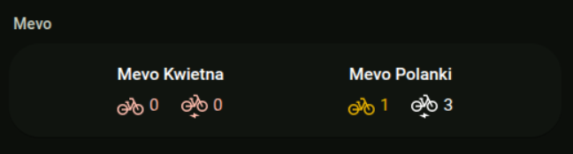
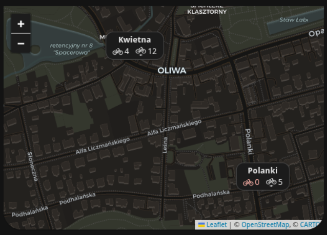

# Mevo Card

Lovelace card for the [ha-mevo](https://github.com/dulek/ha-mevo)
integration. Displays a compact row of badges with available bikes and
e-bikes for each Mevo station you monitor.

[](https://my.home-assistant.io/redirect/hacs_repository/?owner=dulek&repository=ha-mevo-card&category=plugin)





## Installation

### Marketplace or HACS

1. Open the repository using the badge above. If it is not in the catalog yet,
   add it as a custom dashboard plugin when prompted.
2. Install **Mevo Card** in the Marketplace or HACS.
3. Refresh the browser.

### Manual

1. Download `card.js` and place it in `<config>/www/mevo-card/`.
2. In **Settings → Dashboards → Resources**, add
   `/local/mevo-card/card.js` as a JavaScript module.

## Configuration

Add the card from the dashboard editor (search for *Mevo Card*) or
paste this into your dashboard YAML:

```yaml
type: custom:mevo-card
title: Mevo Stations
stations:
  - sensor.station_gda001
  - entity: sensor.station_gda002
    name: Plac Solidarności
```

Switch to map view by adding `view: map`:

```yaml
type: custom:mevo-card
title: Mevo Stations
view: map
stations:
  - sensor.station_gda001
  - sensor.station_gda002
```

### Options

| Option     | Type   | Default | Description                                             |
| ---------- | ------ | ------- | ------------------------------------------------------- |
| `title`    | string | _none_  | Header rendered at the top of the card.                 |
| `view`     | string | `list`  | `list` for chip badges, `map` for a Leaflet map.        |
| `stations` | list   | _req._  | Stations to display.                                    |
| `extra`    | list   | _none_  | Extra indicators per badge: any of `docks`, `capacity` (list view only). |
| `home`     | string | _none_  | Optional entity ID (zone, person, or device_tracker) shown as a home marker on the map and included in auto-fit / fixed-zoom centering. |
| `zoom`     | number | _none_  | Exact zoom level (map view only). When set, disables auto-fit and centers on the stations' (and home, if set) midpoint at this zoom. Omit for auto-fit. |

Each entry under `stations` is either an entity ID string, or an
object with these fields:

| Option   | Type   | Default                                | Description                          |
| -------- | ------ | -------------------------------------- | ------------------------------------ |
| `entity` | string | _req._                                 | The Mevo sensor entity ID.           |
| `name`   | string | sensor's friendly name → entity ID     | Override the badge title.            |

The card reads `bikes_available` and `ebikes_available` from each
sensor's attributes. Counts of `0` are highlighted in the theme's
error color. Map view additionally requires `latitude` and
`longitude` attributes on each sensor, which the
[ha-mevo](https://github.com/dulek/ha-mevo) integration provides.

## Compatibility

Requires the [ha-mevo](https://github.com/dulek/ha-mevo) integration
(or any sensor exposing `bikes_available` / `ebikes_available`
attributes).

## Support

For issues or feature requests, open an issue on GitHub.
